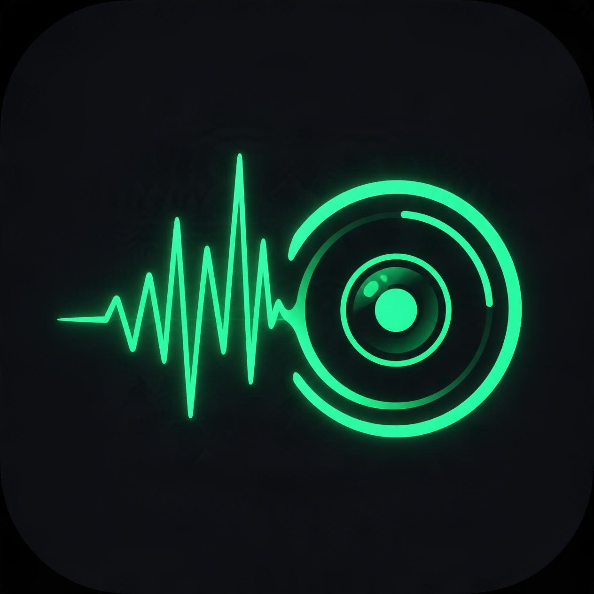

# SDR-Recorder NVR

<p align="center">
  
</p>

<h1 align="center">SDR-Recorder NVR</h1>

<p align="center">
  <strong>CCTV Network Video Recorder (NVR) architecture applied to Radio Communications.</strong><br>
  Continuous 24/7 radio monitoring, intelligent squelch indexing, real-time spectrum analysis, and historical playback for Airband & VHF/UHF.
</p>

<p align="center">
  <a href="https://fastapi.tiangolo.com"></a>
  <a href="https://react.dev"></a>
  <a href="https://www.typescriptlang.org"></a>
  <a href="https://tailwindcss.com"></a>
  <a href="https://www.docker.com"></a>
  <a href="https://opensource.org/licenses/MIT"></a>
</p>

---

## Table of Contents

- [Overview & Architecture](#overview--architecture)
- [Key Features](#key-features)
- [Default Credentials](#default-credentials)
- [Panduan Instalasi Lengkap](#panduan-instalasi-lengkap)
  - [1. Persiapan Sistem & Driver RTL-SDR (Wajib)](#1-persiapan-sistem--driver-rtl-sdr-wajib)
  - [2. Metode A: Instalasi Manual (Bare Metal / Development)](#2-metode-a-instalasi-manual-bare-metal--development)
  - [3. Metode B: Menggunakan Docker Run](#3-metode-b-menggunakan-docker-run)
  - [4. Metode C: Menggunakan Docker Compose (Direkomendasikan)](#4-metode-c-menggunakan-docker-compose-direkomendasikan)
- [Hardware SDR Configuration](#hardware-sdr-configuration)
- [Hardware Detection & Disconnect Safeguards](#hardware-detection--disconnect-safeguards)
- [24-Hour Timeline Scrubber & Continuous Playback](#24-hour-timeline-scrubber--continuous-playback)
- [Storage Auto-Retention Engine](#storage-auto-retention-engine)
- [API Reference](#api-reference)
- [Automated Testing](#automated-testing)
- [Troubleshooting & Solusi Masalah](#troubleshooting--solusi-masalah)

---

## Overview & Architecture

Traditional SDR tools either record continuous raw baseband IQ data (wasting gigabytes per minute of static noise) or stream unbuffered audio directly to speakers. **SDR-Recorder** treats radio monitoring like modern surveillance CCTV / NVR systems:

```
+-----------------------------------------------------------------------------------+
| RTL-SDR Dongle (USB Hardware: RTL2832U / R820T2 / RTL-SDR Blog V3/V4)             |
| [Continuous USB Health Monitoring & Automatic Disconnect Safeguard]                |
+-----------------------------------------------------------------------------------+
                                         │
                                         ▼ Subprocess Pipe
                         `rtl_fm -d <idx> -f <freq> -M <am|fm> -s 24k`
                                         │ Raw PCM 16-bit 24kHz Mono (50ms chunks)
                                         ▼
+-----------------------------------------------------------------------------------+
| AUDIO & SQUELCH PROCESSING PIPELINE (Python Async Engine)                         |
|                                                                                   |
| 1. Compute RMS Power: RSSI_dBFS = 20 * log10(RMS / 32768.0)                      |
| 2. Broadcast RSSI & Squelch state to WebSocket (/ws/live) at 10 Hz                |
| 3. Compare RSSI against Squelch Threshold (Manual or Auto-Squelch Calibrated):    |
|                                                                                   |
|    [ Squelch CLOSED: RSSI < Threshold ]                                           |
|    - Append audio chunk to In-Memory Circular Pre-Roll Buffer (Capacity: 500ms)  |
|    - If active recording was in progress:                                        |
|      - Decrement Hang Time Counter (800ms)                                        |
|      - When Hang Time expires -> Finalize file write & register to SQLite         |
|                                                                                   |
|    [ Squelch OPEN: RSSI >= Threshold ]                                            |
|    - If new transmission:                                                         |
|      - Flush 500ms Pre-Roll Buffer into new Audio File stream                     |
|      - Reset Hang Time Counter to 800ms                                           |
|      - Record transmission start_time & peak RSSI                                 |
|    - Write current audio chunk to active file stream                              |
|    - If Live Audio Monitor is active -> push audio chunk to WebSocket client      |
|                                                                                   |
|    [ Hardware Disconnect Event: USB Unplugged / Hardware Fault ]                  |
|    - Immediately finalize & flush active transmission (prevents file corruption)   |
|    - Broadcast hardware_connected = False & OFFLINE state to WebSocket clients   |
|    - Client displays NoDeviceModal warning; background engine probes for reconnect|
+-----------------------------------------------------------------------------------+
                                         │
                                         ▼ Finalized Transmission
                  Audio File: `storage/recordings/YYYY-MM-DD/ch_<id>_<ts>.opus`
                  Metadata: Insert into SQLite `transmissions` table (WAL Mode)
```

### Core Architecture Components

1. **RTL-SDR Subprocess Ingest Engine:** Reads 16-bit 24 kHz mono raw PCM audio stream from `rtl_fm` using the configured USB dongle. Actively monitors USB device status and immediately halts recording upon disconnect to safeguard data integrity.
2. **DSP Squelch Evaluator:** Evaluates signal root-mean-square (RMS) power in 50ms windows, converting to dBFS (-100 to 0 dBFS). Includes 1-click **Auto-Squelch** hardware noise calibration.
3. **In-Memory Pre-Roll Ring Buffer:** Thread-safe circular buffer holding 500ms (configurable 100ms - 1000ms) of pre-squelch audio. When squelch opens, pre-roll audio is prepended to the recording to guarantee callsigns and initial syllables are never truncated.
4. **Hang Time Tail Buffer:** Holds squelch open for 800ms after signal drops below threshold to avoid file fragmentation during natural speech pauses.
5. **SQLite WAL Mode Database:** High-performance database with Write-Ahead Logging (`PRAGMA journal_mode = WAL`) enabling concurrent reading and writing without database locks.
6. **Supabase Dark Theme Web UI:** Responsive UI crafted according to modern dark theme design tokens (Obsidian `#121212`, Charcoal `#2e2e2e`, Phosphor Green `#3ecf8e`).

---

## Key Features

- **Automated Squelch & Zero-Truncation Recording:** Discards dead air; indexes active transmissions into chronological call logs with pre-roll audio buffers.
- **One-Click Auto-Squelch Calibration:** Automatically samples active channel noise floor and sets optimal squelch threshold (+6 dB above noise floor) with manual override anytime.
- **Hardware Disconnect Safeguards:** Immediately stops recording upon USB unplugging or hardware failure, flags the system OFFLINE, and displays a warning prompt without crashing.
- **Live SDR Spectrum Visualizer:** Real-time audio spectrum analyzer positioned directly above the timeline for immediate visual feedback of active radio traffic.
- **24-Hour Zoomable Canvas Timeline Scrubber:** High-performance HTML5 Canvas renderer displaying 24-hour days with zoom presets (`24h`, `6h`, `1h`, `15m`), wheel zoom, playhead dragging, and Phosphor Green transmission blocks.
- **Chronological Playback & Continuous Auto-Play:**
  - Transport bar with **Next (`⏭`)** and **Prev (`⏮`)** navigation that advances chronologically forward and backward in time.
  - Pressing the main **Play (`▶`)** button enables continuous auto-play, seamlessly advancing to the next call in the archive once the current call finishes.
- **Instant Stop Button in Call History:** Right sidebar call log allows instant stop (`■`) of any currently playing transmission without waiting for audio completion.
- **Historical Multi-Day Calendar Picker:** Interactive calendar popover highlighting days that contain recorded transmissions with phosphor green dots (`●`).
- **Web Audio DSP Voice Filter:** Client-side 300 Hz – 3000 Hz Biquad bandpass filter to eliminate low-frequency hum and high-frequency static hiss.
- **Unified Multi-Tab Settings Modal:** Consolidated management of SDR Dongle parameters (PPM, Gain, Bias-T, Direct Sampling), Channel Presets, Storage Quotas, and Admin Password.
- **Real-Time Storage & Server Health:** Single-line storage capacity indicator connected directly to real filesystem metrics, plus host-synchronized timezone clock.
- **Star Protection & Auto-Retention:** Background retention worker automatically prunes expired recordings or FIFO frees space when disk exceeds quota, while starred calls remain protected forever.

---

## Default Credentials

The system initializes an admin account upon first boot:

| Field | Value |
|---|---|
| **Username** | `admin` |
| **Password** | `12345` |

> *Tip: You can change the admin password at any time via the user menu in the top right corner (`admin ▾` -> Settings -> Password).*

---

## Panduan Instalasi Lengkap

Terdapat 3 cara untuk menjalankan SDR-Recorder NVR:
1. **[Metode A: Instalasi Manual (Bare Metal / Development)](#2-metode-a-instalasi-manual-bare-metal--development)** — Menjalankan langsung di sistem Linux tanpa container. Cocok untuk pengembangan kode, debugging, atau perangkat embedded.
2. **[Metode B: Menggunakan Docker Run](#3-metode-b-menggunakan-docker-run)** — Menjalankan satu perintah container mandiri dengan image resmi dari Docker Hub.
3. **[Metode C: Menggunakan Docker Compose](#4-metode-c-menggunakan-docker-compose-direkomendasikan)** — **Metode yang direkomendasikan** untuk server atau VPS produksi dengan konfigurasi terstruktur, volume persisten, dan auto-restart.

---

### 1. Persiapan Sistem & Driver RTL-SDR (Wajib)

Sebelum menggunakan dongle USB RTL-SDR pada sistem Linux (baik instalasi manual maupun Docker), konfigurasi driver dan hak akses USB berikut wajib dilakukan pada host:

#### A. Blacklist Driver Bawaan Kernel DVB-T
Secara default, kernel Linux mengenali chip Realtek RTL2832U sebagai tuner TV digital (`dvb_usb_rtl28xxu`) dan menguncinya, sehingga `rtl_fm` tidak dapat mengakses raw IQ data SDR. Nonaktifkan modul tersebut:
```bash
echo 'blacklist dvb_usb_rtl28xxu' | sudo tee /etc/modprobe.d/blacklist-rtlsdr.conf
sudo rmmod dvb_usb_rtl28xxu 2>/dev/null || true
```

#### B. Setup Udev Rules (Hak Akses USB)
Agar aplikasi dapat membaca dan mengontrol perangkat USB RTL-SDR tanpa perlu root:
```bash
sudo tee /etc/udev/rules.d/20-rtlsdr.rules << 'EOF'
SUBSYSTEM=="usb", ATTRS{idVendor}=="0bda", ATTRS{idProduct}=="2838", GROUP="plugdev", MODE="0666"
SUBSYSTEM=="usb", ATTRS{idVendor}=="0bda", ATTRS{idProduct}=="2832", GROUP="plugdev", MODE="0666"
EOF

sudo udevadm control --reload-rules && sudo udevadm trigger
```

#### C. Verifikasi Koneksi Hardware
Tancapkan dongle RTL-SDR ke port USB, lalu jalankan:
```bash
lsusb | grep -i rtl
rtl_test -t
```
*Pastikan terminal menampilkan output sukses deteksi tuner (misalnya `Found 1 device(s): ... Realtek RTL2838UHIDIR`).*

---

### 2. Metode A: Instalasi Manual (Bare Metal / Development)

Metode ini menjalankan Python FastAPI backend dan Vite React frontend secara langsung pada host Linux.

#### Kebutuhan Sistem:
- OS: Ubuntu 22.04+, Debian 12+, Raspberry Pi OS 64-bit, atau distro Linux modern lainnya
- Python: 3.11 atau lebih baru
- Node.js: v18+ & npm
- RTL-SDR tools (`rtl_fm`, `rtl_test`) & FFmpeg

#### Langkah 1: Install Paket Dependensi Sistem
```bash
# Ubuntu / Debian / Raspberry Pi OS
sudo apt-get update
sudo apt-get install -y rtl-sdr ffmpeg python3-venv python3-pip nodejs npm git
```

#### Langkah 2: Clone Repository
```bash
git clone https://github.com/aeroslubis/sdr-recorder.git
cd sdr-recorder
```

#### Langkah 3: Konfigurasi File Environment
```bash
cp .env.example .env
# Sesuaikan parameter seperti port atau timezone jika diperlukan
nano .env
```

#### Langkah 4: Setup Virtual Environment Python & Dependensi Backend
```bash
python3 -m venv .venv
source .venv/bin/activate
pip install --upgrade pip
pip install -r requirements.txt
```

#### Langkah 5: Setup & Build Frontend
```bash
cd frontend
npm install
npm run build
cd ..
```

#### Langkah 6: Menjalankan Aplikasi
Pilih salah satu cara berikut sesuai kebutuhan:

- **Opsi 1 — Script Startup Otomatis (Produksi Lokal):**
  ```bash
  ./scripts/start.sh
  ```
  *Script ini akan memverifikasi virtual environment, memastikan dist frontend telah dibuild, dan menjalankan server di `http://0.0.0.0:8000`.*

- **Opsi 2 — Mode Development (Live Hot-Reload):**
  ```bash
  # Terminal 1: Backend API & SDR Ingestion
  source .venv/bin/activate
  python backend/run.py --reload

  # Terminal 2: Frontend Vite Dev Server
  cd frontend
  npm run dev
  ```

- **Opsi 3 — Menjalankan sebagai Systemd Service (Background Service 24/7):**
  Buat file `/etc/systemd/system/sdr-recorder.service`:
  ```ini
  [Unit]
  Description=SDR-Recorder NVR Service
  After=network.target

  [Service]
  Type=simple
  User=aeros
  WorkingDirectory=/home/aeros/workspace/agy/sdr-recorder
  ExecStart=/home/aeros/workspace/agy/sdr-recorder/.venv/bin/python backend/run.py --host 0.0.0.0 --port 8000
  Restart=always
  RestartSec=5
  Environment=PYTHONUNBUFFERED=1

  [Install]
  WantedBy=multi-user.target
  ```
  Aktifkan dan jalankan:
  ```bash
  sudo systemctl daemon-reload
  sudo systemctl enable --now sdr-recorder
  sudo systemctl status sdr-recorder
  ```

Akses Web UI di browser Anda: `http://localhost:8000` (atau IP server Anda) dengan login default: `admin` / `12345`.

---

### 3. Metode B: Menggunakan Docker Run

Metode ini menjalankan container secara mandiri tanpa memerlukan instalasi dependensi Python atau Node.js pada mesin host.

#### Menjalankan Image Resmi dari Docker Hub:
```bash
# 1. Siapkan folder penyimpanan rekaman & database di host
mkdir -p storage

# 2. Jalankan container dengan akses passthrough USB
docker run -d \
  --name sdr-recorder \
  --restart unless-stopped \
  -p 8000:8000 \
  --privileged \
  -v /dev/bus/usb:/dev/bus/usb \
  -v $(pwd)/storage:/app/storage \
  -v /etc/localtime:/etc/localtime:ro \
  -e TZ=Asia/Jayapura \
  -e DEFAULT_ADMIN_USERNAME=admin \
  -e DEFAULT_ADMIN_PASSWORD=12345 \
  putrasukarno/sdr-recorder:latest
```

#### Atau Build Image Sendiri dari Source Code:
```bash
git clone https://github.com/aeroslubis/sdr-recorder.git
cd sdr-recorder

# Build image lokal
docker build -t sdr-recorder:local .

# Jalankan container
docker run -d \
  --name sdr-recorder \
  --restart unless-stopped \
  -p 8000:8000 \
  --privileged \
  -v /dev/bus/usb:/dev/bus/usb \
  -v $(pwd)/storage:/app/storage \
  -v /etc/localtime:/etc/localtime:ro \
  -e TZ=Asia/Jayapura \
  sdr-recorder:local
```

#### Perintah Pemeliharaan Docker:
```bash
# Cek status container
docker ps --filter name=sdr-recorder

# Pantau log secara langsung
docker logs -f sdr-recorder

# Restart container
docker restart sdr-recorder

# Hentikan dan hapus container
docker stop sdr-recorder && docker rm sdr-recorder
```

---

### 4. Metode C: Menggunakan Docker Compose (Direkomendasikan)

Docker Compose adalah metode paling direkomendasikan untuk deployment di server NVR atau VPS karena seluruh konfigurasi, volume disk, dan perangkat USB dikelola secara deklaratif dalam satu file.

#### Langkah 1: Siapkan Folder Deployment & File `docker-compose.yml`
Buat direktori di server Anda (contoh: `~/containers/sdr-recorder`):
```bash
mkdir -p ~/containers/sdr-recorder && cd ~/containers/sdr-recorder
```

Buat file `docker-compose.yml` dengan isi berikut:
```yaml
services:
  sdr-recorder:
    image: putrasukarno/sdr-recorder:latest
    container_name: sdr-recorder
    restart: unless-stopped
    ports:
      - "${SDR_PORT:-8000}:8000"
    environment:
      - TZ=${TZ:-Asia/Jayapura}
      - JWT_SECRET=${JWT_SECRET:-sdr-recorder-secret-key-change-in-production}
      - DEFAULT_ADMIN_USERNAME=${DEFAULT_ADMIN_USERNAME:-admin}
      - DEFAULT_ADMIN_PASSWORD=${DEFAULT_ADMIN_PASSWORD:-12345}
      - DEFAULT_FREQUENCY_HZ=${DEFAULT_FREQUENCY_HZ:-118200000}
      - DEFAULT_MODULATION=${DEFAULT_MODULATION:-AM}
      - DEFAULT_SQUELCH_THRESHOLD=${DEFAULT_SQUELCH_THRESHOLD:--42.0}
      - DEFAULT_AUDIO_FORMAT=${DEFAULT_AUDIO_FORMAT:-opus}
      - DEFAULT_RETENTION_DAYS=${DEFAULT_RETENTION_DAYS:-14}
      - DEFAULT_MAX_DISK_USAGE_PERCENT=${DEFAULT_MAX_DISK_USAGE_PERCENT:-90}
    volumes:
      # Data database SQLite dan audio rekaman tersimpan persisten di host
      - ./storage:/app/storage
      # Sinkronisasi waktu container dengan waktu sistem host
      - /etc/localtime:/etc/localtime:ro
    # Akses hardware fisik RTL-SDR USB dongle
    privileged: true
    devices:
      - /dev/bus/usb:/dev/bus/usb
    logging:
      driver: "json-file"
      options:
        max-size: "20m"
        max-file: "5"
```

> *(Opsional)* Buat file `.env` di sebelah `docker-compose.yml` jika ingin mengubah port atau timezone tanpa mengedit berkas compose:
> ```bash
> cat << 'EOF' > .env
> SDR_PORT=8000
> TZ=Asia/Jayapura
> DEFAULT_ADMIN_USERNAME=admin
> DEFAULT_ADMIN_PASSWORD=12345
> EOF
> ```

#### Langkah 2: Menjalankan Container
```bash
# 1. Unduh image terbaru dari Docker Hub
docker compose pull

# 2. Jalankan container di latar belakang
docker compose up -d
```

#### Langkah 3: Verifikasi Status & Log
```bash
# Pastikan container berstatus Up (healthy)
docker compose ps

# Periksa log aktivitas
docker compose logs -f

# Uji health check API
curl http://localhost:8000/api/health
```

#### Langkah 4: Cara Update ke Versi Terbaru
Ketika ada update versi baru di Docker Hub, lakukan update dengan cepat tanpa downtime panjang:
```bash
cd ~/containers/sdr-recorder
docker compose pull
docker compose up -d
```
Docker Compose akan otomatis mengunduh layer baru dan membuat ulang container. Database SQLite serta seluruh rekaman di folder `./storage` tetap aman dan utuh.

---

---

## Hardware SDR Configuration

SDR-Recorder includes extensive hardware controls accessible via **`admin ▾` -> Settings -> Dongle Configuration**:

- **Device Selection:** Auto-detects connected RTL2832U devices (`Device 0: Realtek...`).
- **Frequency Calibration (PPM Offset):** Crystal oscillator error correction (-100 to +100 PPM).
- **RF Gain Modes:**
  - `Manual`: Fine-grained selection from 0.0 dB to 49.6 dB across standard R820T/R828D gain stages.
  - `Auto AGC`: Automatic Gain Control managed by RTL-SDR tuner.
- **RTL2832 Digital AGC:** Toggles digital automatic gain stage in the demodulator.
- **Hardware Bias-Tee (4.5V DC):** Software toggle to supply phantom power over coaxial cable for active GPS/LNA antennas (supported on RTL-SDR Blog V3/V4).
- **Direct Sampling Modes:**
  - `0`: Disabled (Quadrature, VHF/UHF reception).
  - `1`: Direct Sampling I-branch (HF reception 0 - 24 MHz).
  - `2`: Direct Sampling Q-branch.
- **Audio Engine Buffers:**
  - **Pre-Roll Duration:** 100 ms to 1000 ms (default: 500 ms).
  - **Squelch Hang Time:** 200 ms to 2000 ms (default: 800 ms).

---

## Hardware Detection & Disconnect Safeguards

SDR-Recorder is purpose-built for physical RTL-SDR USB dongles (RTL2832U, R820T2, RTL-SDR Blog V3/V4):

1. **Startup USB Enumeration:** Upon application launch, the engine probes USB buses using `rtl_test` to verify tuner accessibility and extract device serials.
2. **Graceful Disconnect Handling:**
   - If a dongle is unplugged during reception, the audio stream terminates cleanly without throwing unhandled exceptions.
   - Any currently active audio recording is finalized and saved immediately to avoid corrupted or dangling files.
   - Real-time telemetry notifies all connected WebSocket clients with `hardware_connected: false` and the top bar displays `● OFFLINE` (Red).
3. **No-Device Modal & Reconnection:**
   - The frontend automatically surfaces a **No Device Detected** warning modal with a "Retry Hardware Probe" button and a direct shortcut to Dongle Configuration.
   - The backend receiver engine enters a non-blocking retry loop, automatically resuming reception and restoring status to `● RTL-SDR ONLINE` (Green) once the USB device is plugged back in.

---

## 24-Hour Timeline Scrubber & Continuous Playback

The timeline scrubber renders 24 hours of recorded activity onto an HTML5 Canvas:
- **Navigation & Scrubbing:** Click or drag anywhere along the timeline ruler to reposition the playhead.
- **Zoom Presets:**
  - `24h`: Full day overview.
  - `6h`: 6-hour quadrant inspection.
  - `1h`: Hourly breakdown of busy flight corridors or shift handovers.
  - `15m`: High-resolution call-by-call view.
- **Interactive Call Blocks:** Transmission blocks highlight in Phosphor Green (`#3ecf8e`). Clicking any block immediately seeks the playhead and loads the transmission for playback.
- **Continuous Auto-Play:** Pressing the bottom Play button initiates continuous playback through historical calls chronologically.
- **Instant Call Stop:** History call cards feature an active Stop button (`■`) for immediate interruption.
- **Audio Seeking with HTTP 206 Partial Content:** Native `Range: bytes=start-end` support enables instantaneous seeking without buffering entire files.

---

## Storage Auto-Retention Engine

To prevent disk saturation during months of unattended 24/7 monitoring, a background worker runs hourly:
1. **Expiration Purge:** Deletes unstarred recordings older than `retention_days` (default: 14 days).
2. **Quota FIFO Purge:** If disk usage exceeds `max_disk_usage_percent` (default: 90%), older unstarred files are pruned in FIFO order until disk utilization drops below 80%.
3. **Star Protection:** Starred transmissions (`is_starred = 1`) are locked and exempt from automated cleanup.

---

## API Reference

### Authentication
- `POST /api/auth/login`: Authenticate with username and password, returns JWT token.
- `GET /api/auth/me`: Get current authenticated user details.
- `POST /api/auth/logout`: Revoke active session token.
- `POST /api/auth/change-password`: Update account password.

### Radio Tuning & Hardware
- `GET /api/radio/status`: Current frequency, modulation, squelch, and hardware metrics.
- `POST /api/radio/tune`: Adjust frequency, modulation, squelch threshold, or gain.
- `POST /api/radio/auto-squelch`: Trigger automated RF noise floor calibration.
- `POST /api/radio/dongle-config`: Configure PPM, Bias-T, Direct Sampling, and pre-roll buffers.
- `GET /api/radio/presets`: List saved channel presets.
- `POST /api/radio/presets`: Save a new frequency preset.
- `PUT /api/radio/presets/{id}`: Update an existing frequency preset.
- `DELETE /api/radio/presets/{id}`: Delete a saved preset.

### NVR Recordings & Archive
- `GET /api/recordings/timeline?date=YYYY-MM-DD`: Transmission intervals for canvas scrubber.
- `GET /api/recordings/active-dates?month=YYYY-MM`: Calendar dates with recorded calls.
- `GET /api/recordings`: Filtered paginated call log.
- `GET /api/recordings/{id}/audio`: Audio file stream (supports HTTP 206 Partial Content).
- `GET /api/recordings/{id}/download`: Download transmission audio file.
- `POST /api/recordings/{id}/star`: Toggle star protection against retention deletion.
- `POST /api/recordings/{id}/notes`: Update call notes/callsigns.
- `DELETE /api/recordings/{id}`: Permanently delete transmission and audio file.

### System & Live Telemetry
- `GET /api/system/stats`: Hardware status, CPU load, RAM usage, storage metrics.
- `GET /api/system/devices`: List detected USB RTL-SDR devices.
- `GET /api/system/time`: Host server time and timezone info.
- `WS /ws/live`: Real-time 10 Hz RSSI telemetry and live unsquelched audio streaming.

---

## Automated Testing

Run the complete test suite across backend unit tests, frontend components, and end-to-end integration:

```bash
# 1. Run all Python unit & E2E integration tests
.venv/bin/pytest tests/ backend/tests/ -v

# 2. Run React frontend Vitest suite
cd frontend && npm test -- --run
```

---

## Troubleshooting & Solusi Masalah

### 1. `usb_claim_interface error -6` atau Device Busy
- **Penyebab**: Kernel Linux secara otomatis memuat modul DVB-T (`dvb_usb_rtl28xxu`).
- **Solusi**:
  ```bash
  echo 'blacklist dvb_usb_rtl28xxu' | sudo tee /etc/modprobe.d/blacklist-rtlsdr.conf
  sudo rmmod dvb_usb_rtl28xxu 2>/dev/null || true
  ```
  Cabut dan colokkan kembali dongle USB.

### 2. Status di WebUI Menampilkan `● OFFLINE` atau No SDR Hardware Connected
- **Penyebab**: Perangkat USB belum terbaca oleh container atau hak akses udev belum diterapkan.
- **Solusi**:
  1. Periksa apakah dongle terdeteksi di host: `lsusb | grep -i rtl`.
  2. Jika menggunakan Docker Compose, pastikan opsi `privileged: true` dan volume `- /dev/bus/usb:/dev/bus/usb` aktif di `docker-compose.yml`.
  3. Buka popup **Dongle Settings** (ikon gerigi di samping indikator frekuensi) pada tab **Dongle**, lalu klik tombol **Restart Device** untuk memulai ulang proses `rtl_fm`.

### 3. Port USB Mengalami Timeout (`error -110: setup device timeout`)
- **Penyebab**: Hub USB kelebihan beban atau sempat mengalami hardware reset berulang.
- **Solusi**:
  Cabut dongle RTL-SDR dari port USB selama 3 detik, lalu tancapkan kembali ke port USB lain (disarankan port langsung di motherboard / port bertenaga, bukan USB hub pasif).

### 4. Audio Patah-Patah atau Beban CPU Tinggi
- **Penyebab**: Format audio default WAV menghasilkan file besar tanpa kompresi, atau browser client kewalahan me-render animasi.
- **Solusi**:
  - Gunakan format audio **Opus** (default) yang sangat ringan dan efisien.
  - SDR-Recorder telah dioptimasi dengan pembatalan request animation frame (`cancelAnimationFrame`) pada spektrum visualizer untuk rendering 60 FPS yang mulus.
